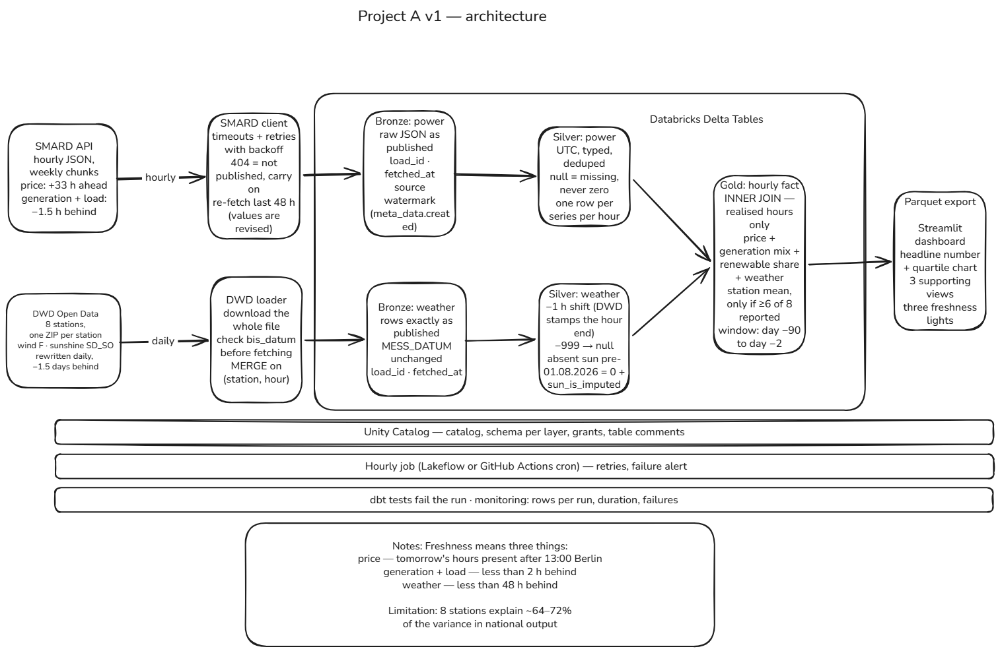

# Germany energy lakehouse


> How much cheaper is Germany's wholesale electricity in windy, sunny hours — and which
> weather produced them? An hourly pipeline over Bundesnetzagentur (SMARD) market data and
> Deutscher Wetterdienst (DWD) weather observations.

**Status:** in development. The sources are researched, the design is fixed and documented
in [`docs/`](docs/); ingestion is the next step. No results are published yet.

---

## The problem

A household on a dynamic electricity tariff pays the hourly wholesale price, and has to
decide when to charge the car or run the heat pump. An energy analyst has to tell whether
an unusual price was explained by the weather or by something else.

SMARD publishes the price, the generation mix and the load; DWD publishes the weather. Each
series is charted on its own, and nothing quantifies the relationship between them. Today
someone has to join the three by eye.

**The question this answers:** over the last 90 days, how much cheaper was the day-ahead
price in hours in the top quartile of wind and solar output than in the bottom quartile,
and which weather conditions produced those hours?

## Architecture



| Layer | What happens | Tools |
|---|---|---|
| Ingestion | SMARD: hourly JSON in weekly chunks, re-fetching the last 48 h because values are revised. DWD: one ZIP per station, downloaded whole and merged | Python, httpx, retries with backoff |
| Bronze | Raw payloads exactly as published, plus `load_id`, `fetched_at` and the source watermark | Delta tables, Databricks Free Edition |
| Silver | UTC, typed, deduplicated; `-999` and `null` become null; every DWD timestamp shifted back one hour | Delta, dbt |
| Gold | Hourly fact joining price, generation mix, renewable share and weather — inner join, realised hours only | dbt |
| Serving | Parquet export to a dashboard with the headline number, the quartile chart and three freshness indicators | Streamlit |
| Orchestration & CI/CD | Hourly job with retries and failure alerts; data tests that fail the run; a monitoring table of rows, duration and failures | Lakeflow / GitHub Actions |

## Data sources

| Source | Series | Licence |
|---|---|---|
| SMARD (Bundesnetzagentur) | day-ahead price DE/LU, realised generation by fuel, grid load — hourly | CC BY 4.0 — *Data: Bundesnetzagentur \| SMARD.de* |
| DWD Open Data | hourly mean wind speed and sunshine duration at 8 stations | CC BY 4.0 — *Datenbasis: Deutscher Wetterdienst, Einzelwerte gemittelt* |

Source research, every filter ID proved against the published CSVs, and every trap found:
[`docs/smard-notes.md`](docs/smard-notes.md) and [`docs/dwd-notes.md`](docs/dwd-notes.md).

## Results

Not measured yet — the pipeline is not built. These are filled with real numbers at v1,
never estimates.

| Measure | Value |
|---|---|
| Headline: price difference, top vs bottom quartile | — |
| Data freshness (source → dashboard) | — |
| Rows per run / total rows | — |
| Pipeline runtime | — |
| Tests (unit / integration / data) | — |
| Monthly cost | — |

## Key decisions

Written up in [`docs/decisions/`](docs/decisions/).

- **Sunshine duration instead of solar radiation.** DWD radiation ends five weeks in the
  past and covers 41 stations; sunshine duration is current and covers 203. Measuring how
  *long* the sun shone rather than how *strongly* is the cost. Radiation moves to v2.
- **Every DWD timestamp is shifted back one hour.** The documentation does not state
  whether a timestamp labels the start or the end of its hour, so it was measured:
  correlating sunshine against solar generation peaked at a one-hour shift (0.846, against
  0.803 at zero and 0.706 the other way). DWD stamps the hour's end; SMARD stamps its start.
- **The gold join is inner, on realised hours only.** The day-ahead price is published
  about 33 hours ahead of real time while generation arrives 1.5 hours behind and weather
  about 1.5 days behind, so a naive join would average over hours that have a price and no
  generation.
- **Sample data is not committed.** It is public, versioned at source, and large. The
  station IDs, URL patterns and row counts in `docs/` are enough to reproduce it.

## How to run it

Requirements: Python 3.12 and [uv](https://docs.astral.sh/uv/).

```bash
git clone https://github.com/sjaddya/energy-lakehouse.git
cd energy-lakehouse
cp .env.example .env        # then fill in real values
uv sync
uv run python -m pytest
```

The commands are written as `uv run python -m <tool>` rather than `uv run <tool>`: on
Windows with Smart App Control enabled, the generated `.exe` launchers inside a virtual
environment are blocked, while running the module is not.

## Testing

- `uv run python -m pytest` — unit tests, no network; external APIs are mocked with respx
- `uv run python -m pytest --run-integration` — also runs tests against the live APIs
- Data-quality tests (dbt) are added with the gold models

## Limitations and next steps

- Eight weather stations stand in for the whole country, and they explain roughly 64–72%
  of the variation in national output. They are weather-service locations, not the places
  where wind and solar capacity actually sits.
- No land station measures the weather at an offshore wind farm.
- The weather arrives about 1.5 days behind, so the analysis window ends two days before
  today and the dashboard says so.
- National figures only: no per-region or per-bidding-zone breakdown, no CO₂ intensity,
  no forecasting. Those are v2 and v3.